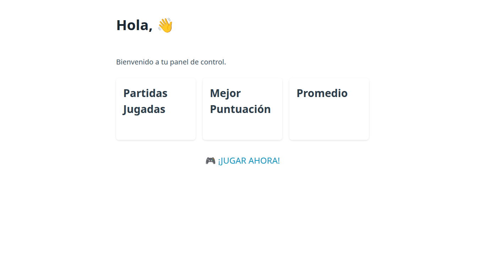

# DeepLens

Herramienta en Python que lee el código de un proyecto web (PHP, HTML, Python...) y, con un modelo de IA que se ejecuta en local, deduce cómo son sus pantallas. Después genera esas pantallas en HTML estático, les aplica estilos y les saca una captura con un navegador automatizado. Sirve para obtener una vista rápida de un proyecto sin tener que montar su servidor ni su base de datos.

Empezó como un prototipo durante mis prácticas en empresa (FCT). Esta versión usa [Ollama](https://ollama.com) en tu propio ordenador.



*Pantalla de perfil generada a partir del código de [GuessIt](https://github.com/soytavodev/GuessIt), sin ejecutar PHP ni MySQL.*

## Cómo funciona

1. **Lee el código** del proyecto. Ignora carpetas pesadas (`node_modules`, `vendor`, `.git`, imágenes) y nunca envía a la IA archivos que suelen tener contraseñas (`db.php`, `database.php`, `config/`, `.env`...). Recorta el texto para no superar el contexto del modelo.
2. **Pide a la IA** las pantallas en formato JSON: nombre, descripción y HTML estático de cada una.
3. **Limpia la respuesta**, porque los modelos a veces añaden texto o bloques de Markdown alrededor del JSON.
4. **Inyecta estilos** con [Pico.css](https://picocss.com), un CSS que da buen aspecto a HTML sin clases.
5. **Saca las capturas** con Playwright (Chromium sin interfaz) y genera un informe en Markdown con las pantallas detectadas.

Todo se guarda en la carpeta `salida/`.

## Resultados en mi prueba

Con el modelo `qwen2.5:1.5b` (unos 1 GB), en una máquina virtual sin tarjeta gráfica:

- Cada análisis tarda entre 1 y 2 minutos.
- Con **GuessIt** generó la pantalla de perfil (arriba), fiel al código: estadísticas y botón para jugar.
- Con **ChangeIt**, en una ejecución generó el formulario completo del conversor y en otras solo el título.
- En los dos casos detectó **una sola pantalla**, aunque GuessIt tiene varias.

Lo que aprendí: un modelo tan pequeño funciona, pero los resultados varían entre ejecuciones y se centra en el primer archivo que lee. Con temperatura 0 las respuestas son siempre iguales, pero no mejores. Para resultados buenos y estables hace falta un modelo más grande (en las prácticas usé uno de 14B en un servidor con GPU). La mejora natural sería analizar archivo por archivo en lugar de todo el proyecto de una vez.

## Instalación y uso

Necesitas Python 3 y [Ollama](https://ollama.com/download).

```bash
git clone https://github.com/soytavodev/DeepLens.git
cd DeepLens

python3 -m venv venv
source venv/bin/activate
pip install -r requirements.txt
playwright install chromium-headless-shell

ollama pull qwen2.5:1.5b

python main.py --path /ruta/a/tu/proyecto
```

Opciones:

- `--path`: carpeta del proyecto a analizar (obligatorio).
- `--out`: carpeta donde guardar las capturas y el informe (por defecto `salida`).

Para usar otro modelo u otra dirección de Ollama, copia `.env.example` como `.env` y edítalo.

## Tecnologías

Python, Ollama (IA local), Playwright, Pico.css y `requests`.

## Autor

Gustavo Delnardo · [GitHub](https://github.com/soytavodev) · [Web](https://gustavo-delnardo.vercel.app)
